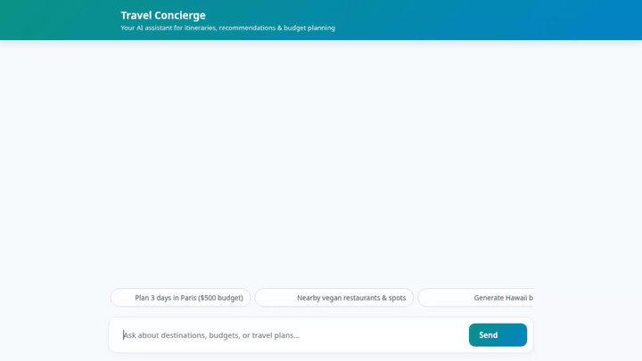

# Travel Concierge Agent

An intelligent, multi-modal AI Travel Concierge built with Google Cloud Agent Development Kit (ADK), Vertex AI Agent Platform, and Gemini models. The agent helps travelers discover destinations, search curated database catalogs, plan custom itineraries, compute trip budgets, and generate visual postcards and videos—all with cross-session memory and rich A2UI card interfaces.



---

## Key Features & Wired-Up Architecture

The Travel Concierge Agent implements the following capabilities directly wired into Google Cloud services and ADK tools:

### 🧠 Cross-Session Long-Term Memory
- **Vertex AI Memory Bank**: Powered by `VertexAiMemoryBankService` and `PreloadMemoryTool`. Automatically remembers user preferences, dietary restrictions, health requirements, and allergies across sessions, personalizing future destination and dining suggestions.

### 🗄️ Cloud Firestore Travel Database
- **Firestore Integration**: Queries and manages destination catalogs (`search_destinations`, `add_destination`), allowing travelers to search by budget, rating, and category or add new locations.

### 🖼️ & 🎥 Media Generation & Cloud Storage
- **Postcard Image Generation**: Powered by `gemini-3.1-flash-lite-image` via `generate_destination_postcard`.
- **Destination Video Generation**: Powered by `gemini-omni-flash-preview` in the `global` region via `generate_destination_video`.
- **Public Cloud Storage Hosting**: Saves artifacts locally for ADK Playground and uploads in-memory bytes directly to a public Google Cloud Storage bucket (`travel-concierge-media-*`) to return public HTTPS URLs.

### 💻 Code Execution Sandbox
- **AgentEngineSandboxCodeExecutor**: Safe execution of Python code in a containerized cloud sandbox for calculating complex trip budgets, currency conversions, and data analysis (`calculate_trip_budget`).

### 🗺️ Maps & Geolocation Tools
- **Google Maps Geocoding & Places**: Converts addresses to geographic coordinates (`geocode_address`) and finds nearby attractions, restaurants, and lodging (`find_nearby_places`).
- **Live Exchange Rates**: Fetches real-time foreign currency exchange rates via Frankfurter API (`get_live_exchange_rates`).

### 🎨 A2UI Protocol & Custom Chat Frontend
- **A2UI v0.8 Integration**: Generates structured A2UI layout cards (`A2uiSchemaManager`, `BasicCatalog`) for rich visual display of places and itineraries.
- **FastAPI A2A Proxy Frontend**: Custom web application (`frontend/`) communicating over the A2A protocol, featuring custom branding, prompt chips, and responsive dialogue bubbles.

---

## Status of Brief Features

| Feature | Status | Notes |
|---|---|---|
| Cross-session Memory (Dietary/Allergies) | ✅ Implemented | Vertex AI Memory Bank |
| Firestore Catalog Search | ✅ Implemented | Google Cloud Firestore |
| Geocoding & Nearby Places | ✅ Implemented | Google Maps APIs |
| Postcard Image Generation | ✅ Implemented | Gemini 3.1 Flash Lite Image |
| Omni Video Snippet Generation | ✅ Implemented | Gemini Omni Flash (Global) |
| Python Budget Sandbox | ✅ Implemented | ADK Code Executor Sandbox |
| Live Currency Exchange Rates | ✅ Implemented | Frankfurter API |
| A2UI Rich Visual Rendering | ✅ Implemented | A2UI v0.8 Schema Manager |
| Live Flight & Hotel Booking Engine | ⏳ Planned / Not Implemented | Mock/Catalog search available |

---

## Setup & Local Execution Instructions

### Prerequisites
- Python 3.11+
- Google Cloud SDK (`gcloud`)
- `uv` package manager (`pip install uv`)

### 1. Environment Setup & Configuration
Set required Google Cloud credentials and environment variables:

```bash
gcloud auth login
gcloud auth application-default login
export GOOGLE_CLOUD_PROJECT="<your-gcp-project-id>"
export GOOGLE_MAPS_API_KEY="<your-google-maps-api-key>"
```

### 2. Install Dependencies
```bash
uv sync
```

### 3. Run Agent Playground Locally
Start the ADK development web UI to interact with the agent locally:

```bash
adk web app/
```

### 4. Run Custom Chat Frontend Locally
To run the custom web app frontend locally:

```bash
cd frontend
export AGENT_ENGINE_RESOURCE_NAME="projects/<project-id>/locations/<region>/reasoningEngines/<engine-id>"
export AGENT_DIRECTORY="app"
export PORT=8080

uv run python main.py
```

---

## Deployment Instructions

### Deploy Agent to Agent Runtime
Deploy the agent engine using `agents-cli`:

```bash
agents-cli deploy agent_runtime app \
  --memory_bank_id "<memory-bank-id>" \
  --update-env-vars GOOGLE_MAPS_API_KEY="$GOOGLE_MAPS_API_KEY"
```

### Deploy Frontend to Cloud Run
Build and ship the containerized chat UI to Cloud Run:

```bash
gcloud run deploy travel-concierge-frontend \
  --source ./frontend \
  --region us-east1 \
  --allow-unauthenticated \
  --set-env-vars AGENT_ENGINE_RESOURCE_NAME="<reasoning-engine-resource-name>",AGENT_DIRECTORY="app"
```

Grant Cloud Run Invoker role:
```bash
gcloud projects add-iam-policy-binding <your-gcp-project-id> \
  --member="serviceAccount:<project-number>-compute@developer.gserviceaccount.com" \
  --role="roles/aiplatform.user"
```
